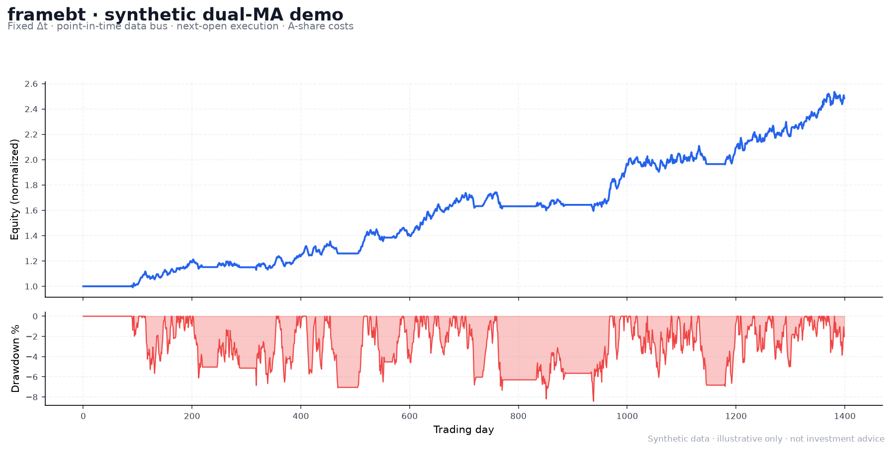

# framebt

**A-share causal backtesting engine · 面向 A 股的帧刷新因果回测框架**

[](LICENSE)
[](pyproject.toml)
[](tests/test_capability_gate.py)
[](pyproject.toml)
[](https://github.com/LisonEvf/framebt/issues)
[](https://github.com/LisonEvf/framebt)

> 回测里最贵的 bug，不是模型不够复杂，而是**用今天收盘的信号，在今天开盘成交**。
>
> framebt 把这条变成引擎的硬约束：固定 Δt 推进时间、`CausalToken` 强制 point-in-time 数据访问、
> 帧 t 决策 → **帧 t+1 开盘成交**。T+1、涨跌停、成本、账本都可逐笔独立复算。

**framebt** is a deterministic, causal backtesting engine for China A-shares (stocks and ETFs).
It turns **look-ahead bias, T+1 settlement, price limits and cost accounting** into structural
constraints instead of coding conventions. The core engine has **zero third-party dependencies**.

[为什么](#why-framebt--为什么是-framebt) ·
[快速开始](#quick-start--快速开始) ·
[核心能力](#whats-inside--核心能力) ·
[验证](#verified-not-claimed--验证而非自述) ·
[文档](#documentation--文档地图) ·
[已知边界](#known-boundaries--已知边界)

---

## Demo



*Synthetic 1,400-bar dual-MA demo with A-share costs; illustrative only, not investment advice.*

---

## Why framebt? / 为什么是 framebt

大多数回测框架能让你「跑出一个数字」，但很难证明这个数字**不是前视、不是杠杆、不是把未来
数据混进了窗口**。framebt 的设计围绕一件事：**让错误的结构性发生不了，让正确的结果可以被外部复算。**

| 常见回测问题 | framebt 的机制 |
|---|---|
| 用收盘价生成信号，又用当天开盘价成交 | 引擎 I2 延迟管线：帧 t 的订单最早帧 t+1 开盘成交 |
| 滚动窗口/因子偷偷看到未来 | `CausalToken` + 权威虚拟时间钳制；负 lag 直接 `CausalityViolation` |
| 策略改写历史、篡改时钟 | 引擎私有 key 的 I5 写保护；`record / set_now / reset` 仅引擎可用 |
| T+1、涨跌停、停牌、成本各写各的 | `rules.py` / `ledger.py` / `cost.py` 统一中间件，逐笔计入 `FillEvent.cost` |
| 同一配置两次结果不同 | 固定 Δt + `DetermRNG` + float 确定性；同配置逐位复现 |
| 账本黑箱，无法对账 | 用 `FillEvent` 明细可独立重算现金/权益；CAPABILITY 报告实测零偏差 |
| 只对某个策略「恰好正确」 | 随机订单、前缀不变性、变异测试、外部策略复刻共同验证 |

**适合谁**：做 A 股/ETF 日线或日内研究、在意因果性与可复现性、希望把回测结果拿去实盘复用同一套
策略代码的量化开发者。**不适合**：只要一个「快速画出漂亮曲线」的黑箱，或需要完整 L2 盘口/期权
生命周期的生产级系统（见[已知边界](#known-boundaries--已知边界)）。

---

## Quick start / 快速开始

要求 **Python 3.12+**。核心引擎零第三方依赖；读 Parquet 数据与画图才需要 extras。

```bash
git clone https://github.com/LisonEvf/framebt.git
cd framebt

pip install -e .              # 核心：只依赖标准库
pip install -e ".[all]"       # + pandas/pyarrow/matplotlib/pytest
```

### 30 秒：不接数据也能跑

```python
import math
from framebt import run_backtest, Performance
from framebt.strategies import DualMAStrategy

def bar(i: int) -> dict:
    c = 100 + 10 * math.sin(i / 10) + i * 0.05
    return {"timestamp": i, "symbol": "S",
            "open": c, "high": c * 1.01, "low": c * 0.99, "close": c,
            "volume": 1_000_000.0}

res = run_backtest([bar(i) for i in range(400)],
                   DualMAStrategy("S", short=5, long=20),
                   symbol="S", initial_cash=100_000.0)
print(f"final={res.final_equity():,.2f}  return={Performance(res).total_return:+.2%}")
```

### 用真实 A 股数据 + 完整 A 股规则

```python
from framebt import (Engine, Performance, StandardCost, StandardRisk,
                     StandardAshareRules)
from framebt.data_sources import OpentdxParquetSource
from framebt.strategies import DualMAStrategy

src  = OpentdxParquetSource()          # 默认 ../opentdx/db/data，可用 FRAMEBT_DATA_DIR 覆盖
feed = src.load("SH.600519")           # DAILY + QFQ

engine = Engine(
    feed,
    DualMAStrategy("SH.600519", short=5, long=20),
    initial_cash=1_000_000.0,
    settlement_cycle=1,                                  # T+1
    cost_model=StandardCost(commission=0.0003, min_commission=5.0,
                            stamp_tax=0.001, slippage="sqrt"),
    risk=StandardRisk(max_position_pct=0.95),
    rules=StandardAshareRules(limit=0.10),               # ±10% 涨跌停（可配置）
)
res = engine.run()
print(res.final_equity(), Performance(res).sharpe)
```

没有本地数仓？直接跑合成数据示例：

```bash
python examples/demo_quickstart.py        # 无外部数据时自动使用合成数据，生成 HTML 报告
```

---

## What's inside / 核心能力

| 模块 | 能力 |
|---|---|
| **因果数据总线** `data_bus.py` | 每帧签发 `CausalToken`；`lag` 原语；横截面 `cross_section`；多时间框架 `get_multi_tf`；I5 写保护 |
| **执行/撮合** `execution/` | MARKET / LIMIT / STOP / STOP_LIMIT / TRAILING / IOC / FOK；价格-时间优先订单簿；FIFO 成交量分摊；部分成交跨帧续接 |
| **订单组** `execution/groups.py` | OCO（一单成交撤销其余）、Bracket（入场 + 止盈/止损）、`all_or_none` 原子性 |
| **账本** `ledger.py` | 多腿持仓、FIFO 已实现盈亏、T+1 可卖量、拆股/分红/退市现金结算 |
| **A 股规则** `rules.py` | 涨跌停、停牌、交易日历、T+1；`SELL_SHORT` 可借量/保证金 |
| **成本/风控** `cost.py` / `guard.py` | 佣金（最低 5 元）、印花税、过户费、比例/平方根/成交量滑点；盘前风控、在途资金预留 |
| **多因子体系** `factors/` | 57 个 WQ101/GTJA191 风格因子、IC/ICIR/Newey-West t、分组单调性、预处理 |
| **组合与监控** `portfolio/` / `monitor/` | 在线权重、市场状态门控、CUSUM 变点 + 卡尔曼平滑、三级预警 |
| **自主发现** `discovery/` | 符号回归（自实现遗传规划）、神经网络隐因子、正交化/VIF/影子运行入栈 |
| **实盘地基** `live.py` | `LiveFeed` / `LiveConnector` / `Transport` 抽象，策略与引擎调度可复用 |
| **图表报告** `report.py` | 自包含 HTML：权益、回撤、K 线、成交；matplotlib 惰性导入 |

核心不变式（也是测试判据）：

| # | 不变式 |
|---|---|
| **I1** | 任何数据请求返回的记录 `timestamp <= current_virtual_time` |
| **I2** | 帧 t 生成的订单，最早成交于帧 t + `delay_frames`（默认 1） |
| **I3** | 相同配置逐位可复现 |
| **I4** | 帧内多 Bar 按 `(timestamp, sequence_id)` 严格排序 |
| **I5** | 策略不能通过公开 API 改写已过去帧/篡改权威时间（私有属性不设防） |

---

## Verified, not claimed / 验证而非自述

这个仓库把「验证」当成一等公民：**预登记判据、独立实现复算、外部数据对照、变异测试，
以及没通过的结果，都留在 `reports/` 里。**

| 验证 | 结果 |
|---|---|
| 全量测试 | **422 passed + 7 xfailed（共 429）**；7 条是显式登记的建模边界 |
| 独立 oracle 复算 | 6 个策略的成交/成本/逐帧权益与独立实现一致，最大偏差 **4.7e-10 元** |
| I1 因果攻击 | 1,406 次伪造 token 尝试 + 负 lag 请求，**0 次逃逸** |
| 真实数据 | 5,575 标的 / 15,577,265 根 DAILY/QFQ Bar（2026-10-19 口径） |
| 变异测试 | 向源码副本注入 15 个已知 bug，门禁 **15/15 全部杀死** |
| 外部策略复刻 | Faber / GEM / 永久组合的 L1 逐笔一致；L2 数据商存在 QFQ 回撤差；L3 方向成立、幅度未复现 |
| **如实保留的失败** | 多因子系统样本外 **−78.55%**；CAPABILITY 的 P5b/P7 未通过；REPLICATION 的 L2 未通过 |

- 端到端逐笔对账：[`reports/CAPABILITY.md`](reports/CAPABILITY.md)
- 「真实可用」门禁 + 变异：[`reports/USABILITY.md`](reports/USABILITY.md)、[`reports/MUTATION.md`](reports/MUTATION.md)
- 外部策略复刻：[`reports/EXTERNAL_REPLICATION.md`](reports/EXTERNAL_REPLICATION.md)
- 全市场逐项扫描：[`reports/VALIDATION.md`](reports/VALIDATION.md)

> **框架正确 ≠ 策略赚钱。** 本仓库不承诺任何策略的正收益，也不把回测结果当成投资建议。

---

## A-share rules / A 股规则

```python
StandardAshareRules(limit=0.10, settlement_cycle=1)
```

| 规则 | 默认行为 |
|---|---|
| 涨跌停 | 相对昨收 ±`limit`；涨停拒买、跌停拒卖 |
| T+1 | 买入腿在 `entry_frame + settlement_cycle` 后才可卖 |
| 停牌/日历 | `suspended=` 集合或 callable；`trading_days=` 逻辑时间戳集合 |
| 整手 | 策略/示例按 100 股取整；引擎不强制 lot（由策略决定） |
| 成本 | 佣金 3bp（最低 5 元）· 印花税 5bp（仅卖）· 过户费 0.2bp · 滑点可配 |
| 做空 | `SELL_SHORT` + `float_shares` 可借量代理 + 保证金比例；借券费/强平未实现 |

> 涨跌停默认是**单一 `limit` 参数**，不会按创业板/科创板 20%、北交所 30% 自动切换；
> 需要时请显式传不同 `limit` 或自定义 `MarketRules`。

---

## Architecture / 架构

```text
BarFeed / LiveFeed
        │  (timestamp, sequence_id) 全序
        ▼
Engine.step(Δt) ──► DataBus.record(engine key)
        │                 │
        │                 ▼
        │            Strategy.on_frame(frame, token, bus, host)
        │                 │  orders
        ▼                 ▼
MatchingEngine ◄──── delay_frames ≥ 1 (I2)
        │  fills (price/time priority, volume allocation)
        ▼
Ledger + Rules + Cost ──► BacktestResult (fills, equity, performance)
```

每帧四阶段：**注入 → 唤醒 → 撮合 → 记账**。空时间段折叠；数据耗尽但仍有在途订单时生成
静态帧撮合。完整设计见 [`docs/PHASE6.md`](docs/PHASE6.md) 与 [`USER_GUIDE.md`](USER_GUIDE.md)。

---

## Examples / 示例

| 示例 | 内容 |
|---|---|
| [`demo_quickstart.py`](examples/demo_quickstart.py) | 零外部数据 + HTML 报告 |
| [`dual_ma_real.py`](examples/dual_ma_real.py) | 真实数据双均线 |
| [`multi_factor_universe.py`](examples/multi_factor_universe.py) | 横截面动量（默认 200 只，`--max-symbols` 可调） |
| [`conditional_stop_loss.py`](examples/conditional_stop_loss.py) | 趋势 + 条件止损 |
| [`bracket_oco.py`](examples/bracket_oco.py) | 入场 + OCO 止盈/止损 |
| [`rotation_momentum.py`](examples/rotation_momentum.py) | 轮动 + 选股器/预算策略 |
| [`rotation_trend_ma.py`](examples/rotation_trend_ma.py) | 轮动 + 趋势过滤 |

```bash
python examples/demo_quickstart.py
python examples/multi_factor_universe.py --max-symbols 200
```

---

## Documentation / 文档地图

| 文档 | 内容 |
|---|---|
| [`docs/INDEX.md`](docs/INDEX.md) | 文档总入口：设计/预登记、验证报告、历史归档 |
| [`USER_GUIDE.md`](USER_GUIDE.md) | 从安装到第一个回测、订单/规则/成本/API 实操 |
| [`docs/MULTIFACTOR.md`](docs/MULTIFACTOR.md) | 多因子系统落地说明与实现边界 |
| [`docs/ETF_TREND.md`](docs/ETF_TREND.md) | 多资产 ETF 趋势预登记与结果（含失败项） |
| [`docs/GATE_USABILITY.md`](docs/GATE_USABILITY.md) | 「真实可用」门禁预登记（G1–G8） |
| [`docs/REPLICATION.md`](docs/REPLICATION.md) | 外部策略复刻预登记 |
| [`reports/INDEX.md`](reports/INDEX.md) | 验证报告索引：每份报告回答什么问题 |

---

## Known boundaries / 已知边界

诚实声明，避免把研究框架当生产系统：

1. **日线/Bar 级近似**：撮合用 Bar 的 open/high/low，不建模逐笔盘口深度、跨价位排队和真实冲击。
2. **`LIMIT`/`STOP` 是帧内近似**：限价按「限价或更优开盘」；止损用 high/low 穿越触发；不是逐笔路径模拟。
3. **默认 `risk=NoOpRisk()` 不拦超买**：策略绕过 `host.has_pending` 重复下单会透支；严肃回测请显式用 `StandardRisk`。
4. **涨跌停单一参数**：不自动区分主板/创业板/科创板/北交所；见 §A 股规则。
5. **I5 只保护公开 API**：Python 无法阻止访问 `bus._series` 等私有属性。
6. **做空不完整**：有 `SELL_SHORT`、可借量、保证金；**借券费/强平未实现**。
7. **数据尾部**：数据耗尽但仍有在途订单时，会生成静态帧撮合；尾部订单不等于真实可成交。
8. **数据质量**：本地 QFQ 为加法式前复权，可能与 Yahoo/其他数据商的最大回撤差 >5pp；长历史回测前先做数据体检。
9. **策略结果不外推**：存活偏差、单一样本区间、成本假设都会改变结论；本项目不构成投资建议。

更多边界与门禁项见 [`docs/GATE_USABILITY.md`](docs/GATE_USABILITY.md) §5 与 [`reports/USABILITY.md`](reports/USABILITY.md)。

---

## Status / 路线图

| 阶段 | 状态 |
|---|---|
| Phase 0–4：骨架 / 因果总线 / 订单语义 / 账本规则 / 成本风控 | ✅ 完成 |
| Phase 5：策略宿主（`on_frame` / `on_sub_step` / `on_fill`） | 🟡 事件/条件/调度/lifecycle 为保留接口 |
| Phase 6：帧内子步进、订单簿、做空、实盘地基 | 🟡 期权生命周期、帧内事件队列、多市场混合总线仍路线图 |

欢迎贡献：A 股板块化涨跌停、逐笔/Tick 事件队列、更多数据源适配器、实盘 broker adapter、
文档与测试。开发约定见 [`docs/INDEX.md`](docs/INDEX.md)。

```bash
pip install -e ".[all]"
python -m pytest
python -m pytest -q tests/test_capability_gate.py   # 「真实可用」门禁，秒级
```

---

## License / 许可

MIT。见 [`LICENSE`](LICENSE)。

**Keywords**: A-share backtesting, quantitative finance, causal backtesting, point-in-time data,
look-ahead bias, Python backtester, algorithmic trading, T+1, price limit, ETF, momentum,
multi-factor, deterministic simulation, China stock market.
