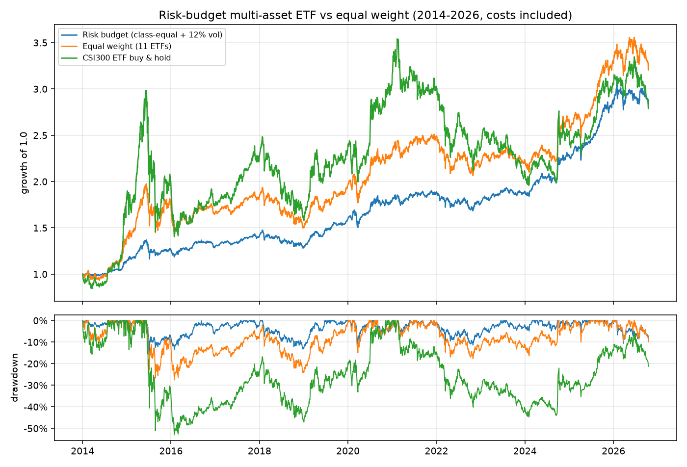

# 风险预算多资产 ETF · 一套基于 framebt 的交易策略

> 状态：**设计 + 原型**（2026-10-21）。样本内 2014-01 → 2026-10，非实盘验证，
> 不构成投资建议。原型：`examples/risk_budget_etf.py`；筛选：`tools/etf_weight_screen.py`。
>
> **这不是一份事前预登记。** 本文是「先有设计、再跑原型、如实记录」的复盘；
> §7 的判据是为**下一轮真正的样本外验证**钉的口径。本轮结果与设计在同一段样本上，
> 因此只能叫「样本内证据」，不能叫 OOS。

---

## 0. 一句话

**不预测方向，只分配风险。**

4 个资产类别各拿 25% 资本，类别内等权；组合 60 日实现波动超过 12% 时按比例降仓，
不足部分放货币 ETF；每 21 个交易日调仓，偏离目标 1% 以上才动手。
不做选股、不做趋势择时、不加杠杆——因为本项目的实测已经把这两条路证伪了。

---

## 1. 为什么策略必须长成这个形状

### 1.1 框架给了什么、没给什么

| framebt 的能力 | 对策略设计的硬约束 |
|---|---|
| 日线 / Bar 级撮合，无 L2 盘口 | 高频、盘口套利、逐笔冲击建模不在射程 |
| `CausalToken` + 帧 t 决策 → 帧 t+1 开盘成交（I2） | 任何「当天收盘价成交」的回测都不可信；信号只能用到 t 收盘 |
| T+1、涨跌停、停牌、成本、账本 | 换手是头号敌人；策略必须**扣费后**仍然活着 |
| 默认 long-only，`SELL_SHORT` 不完整 | 多空对冲、市场中性、融券套利不在射程 |
| 组合 / 监控 / 变点 / 健康度 | 风险预算、波动目标、状态监控有现成积木 |
| 预登记 + 独立复算 + 变异测试 | 结论必须能被第二套实现复算，失败必须保留 |

### 1.2 已经被本框架证伪的路径

| 路径 | 实测结果 | 出处 | 判决 |
|---|---|---|---|
| 横截面选股（前 500 流动性池，8 年 OOS） | 年化 **+0.01%**、回撤 **58.95%**、换手 **36.2×**、费用吃掉 **53.84%** 本金 | `docs/PATH_200K.md` §8 | 死 |
| 自适应多因子（500 标的，含在线学习/门控/生命周期） | 总收益 **−78.55%**、回撤 **97.39%**、费用 **267%** 本金 | `reports/ADAPTIVE.md` | 死 |
| ETF 趋势择时（TSMOM + MA200） | 年化 9.10% < 等权 10.02%；配对自举置信区间跨 0 | `docs/ETF_TREND.md` §6.3–6.4 | 无证据 |
| 日内 T（底仓 + 扫单） | **−2.12%** | `reports/INTRADAY_SWEEP.md` | 死 |
| 动态因子权重（在线 GD + 健康 + 生命周期） | 两个样本上符号相反，量级 ~1pp/年 | `docs/PATH_200K.md` §8.11 | 噪声 |

这五条不是「还没调好」，而是**机制性失败**：

1. **广度锁死**：20 万 + 1 手最小单位 → 现实只能持 3~6 只。日频 IC 0.03~0.05 的选股信号，
   放在 5 只票上，年化期望只有 2~4%，低于摩擦和噪音。
   （基本法则：`IR ≈ IC × √breadth`。）
2. **摩擦吃光**：36× 年换手 × 0.08% 混合费率 ≈ 6%/年；ETF 约 0.03%，摩擦直接降到 1/3。
3. **择时没有可证伪的价值**：趋势与波动目标都无法在统计上区别于朴素等权。
4. **动态加权是噪声**：换样本符号就反。

→ **推论：在 20 万 + 日线 + T+1 的约束下，收益不能来自「预测哪只涨」，
只能来自「承担哪些风险、承担多少」。** 这正是框架最擅长记账的部分。

---

## 2. 策略总览

```text
L1 配置层   4 类资产 × 25% 资本；类别内等权
              ↓  目标权重
L2 风险层   60 日组合波动 > 12% → 按比例降仓；剩余 → 货币 ETF
              ↓  带现金腿的目标权重
L3 执行层   每 21 交易日调仓；偏离 ≥1% 才下单；100 份整手；次帧开盘市价
              ↓  FillEvent
L4 监控层   CUSUM 变点 + 卡尔曼平滑 + 三级预警（只告警，不改仓）
```

| 层 | 作用 | framebt 对应模块 |
|---|---|---|
| L1 配置 | 决定长期风险敞口 | `portfolio/weights.py`、`portfolio/combine.py` |
| L2 风险 | 把组合波动压到可承受区间 | `guard.py`、`portfolio/gating.py` |
| L3 执行 | 把换手和成本压到最低 | `execution/`、`cost.py`、`rules.py` |
| L4 监控 | 发现「策略失效」而不是「行情不好」 | `monitor/changepoint.py`、`monitor/health.py` |

**关键设计原则：L4 不参与交易。** 监控层一旦能改仓位，就会退化成第六个未经验证的择时信号。

**术语说明**：这里的「风险预算」= 先按资产类别分配**资本预算**（各 25%），
再用波动率目标约束**组合总风险**；不是 ERC（等风险贡献）。
ERC 在无杠杆下会把低波资产（债券）权重推得很高，组合波动只有 ~4%、
年化 ~6.6%（见 §4.2 筛选表），对 20 万本金收益太低。
资本预算 + 波动目标是在「收益够用」和「回撤可承受」之间的折中，不是理论最优。

---

## 3. 规则（可复现，无隐藏参数）

### 3.1 标的池：按资产类别，不按历史业绩

| 类别 | 标的 | 类别内权重 |
|---|---|---|
| A 股宽基 | 510050 上证50 · 510300 沪深300 · 510500 中证500 · 159915 创业板 · 512100 中证1000 | 等权 |
| 海外股票 | 159920 恒生 · 513100 纳指 · 513500 标普500 | 等权 |
| 债券 | 511010 国债 · 511260 十年国债 | 等权 |
| 黄金 | 518880 黄金 | 100% |
| 现金腿 | **511990 华宝添益（货币 ETF）** | 残差 |

**偏误声明**：这份菜单是「资产类别」选择，不是「哪只涨得好」的选择；
但标的池本身是**今天的存续者**，退市 ETF 缺失。宽基/债券/黄金/海外 ETF 退市率低，
故偏误有限，但**不被消除**。

### 3.2 权重

```text
w_class = 1 / 4                         # 每个资产类别 25% 资本
w_i     = w_class / n_class             # 类别内等权
```

- 某类别当天没有合格标的（未上市/流动性不足）→ 该类别权重进现金，
  **不挤给其他类别**。否则某个类别暂时缺席时（例如 2012–2013 年海外 ETF 尚未上市），
  风险会被动挤向 A 股，组合会悄悄退化成「A 股 + 一点黄金」。
- PIT 资格：上市满 60 个交易日 + trailing 20 日均成交额 ≥ 2000 万。

### 3.3 波动率目标

```text
σ_t   = std(组合过去 60 日收益) × √252
scale = min(1, 0.12 / σ_t)              # 只降不升，不加杠杆
w_i  *= scale
w_cash = 1 − Σ w_i
```

- 目标 12% 是**风险预算**，不是收益预测；无杠杆，所以只能降不能升。
- 现金腿放货币 ETF（有票息、T+0、无印花税），比空仓现金强。

### 3.4 调仓与下单

| 项 | 取值 |
|---|---|
| 调仓频率 | 每 21 个交易日（约月度） |
| 交易带 | 目标与当前偏离 < 1% 权益 → 不动 |
| 卖出 | 只在调仓帧卖（避免日内反复） |
| 买入 | 非调仓帧也可向目标靠拢（用新增现金） |
| 订单 | MARKET，次帧开盘成交（引擎 I2） |
| 整手 | 100 份 |
| 最小成交额 | 1% 权益（约 2000 元），低于此不下单 |

### 3.5 成本

| 项 | 取值 |
|---|---|
| 佣金 | 万 1.5（最低 5 元/笔） |
| 印花税 | **0**（ETF 免征） |
| 过户费 | **0**（ETF 免征） |
| 滑点 | 比例 3bp |

---

## 4. 为什么每一层能站住

### 4.1 配置层：跨资产分散是唯一被实测支持的收益来源

`docs/ETF_TREND.md` §6.5 的稳健性表：

| 菜单 | 年化 | Sharpe | 最大回撤 |
|---|---|---|---|
| 全菜单（11 只） | +10.02% | 0.73 | 28.54% |
| 剔除黄金 | +9.79% | 0.66 | 31.75% |
| 剔除海外 | +8.46% | 0.57 | 37.86% |
| **仅 A 股宽基（5 只）** | **+7.99%** | **0.43** | **57.83%** |

**只留 A 股宽基就退化成「高 beta 单一资产」**；价值来自类别之间的低相关，
不是来自某一类资产。这就是「广度来自资产类别 × 时间，而不是持仓只数」。

### 4.2 为什么是「类别等权」而不是「标的等权」

按标的等权时，A 股 5 只 / 11 只 = **45%** 资本，海外 27%、债券 18%、黄金 9%——
所谓「多资产」实际上是一个 A 股主导的组合。

按类别等权后：A 股 25%、海外 25%、债券 25%、黄金 25%。
同类别内的 5 只 A 股 ETF 相关性很高，**它们不提供分散，只提供同一风险的 5 个副本**；
真正提供分散的是类别之间。

近似筛选（`tools/etf_weight_screen.py`，3bp 成本、无引擎）：

| 方案 | 年化 | Sharpe | 回撤 | 波动 |
|---|---|---|---|---|
| 标的等权 | +9.92% | 0.72 | 28.55% | 14.54% |
| 类别等权 | +9.71% | **0.97** | **17.06%** | 10.06% |
| 类别内 ERC | +9.98% | 1.01 | 16.46% | 9.86% |

收益几乎不变，**回撤减半、Sharpe +0.25**。这是「少承担了不被补偿的风险」，
不是「多赚了 alpha」。

### 4.3 风险层：波动率目标是刹车，不是油门

Moreira & Muir (2017)：波动率聚集使「高波动期低仓位」有风险调整收益。
`docs/ETF_TREND.md` §6.3 的消融显示：波动目标的贡献方向一致——
Sharpe +0.05~+0.18、回撤 −6.8~−10.8pp，代价是年化 −0.5~−1.5pp。

本策略里它只在 16% 的调仓帧触发（组合波动 > 12%），
作用是**危机时自动降仓**，不是日常择时。

### 4.4 执行层：ETF 的摩擦是股票的 1/3

| 项 | 股票 | ETF |
|---|---|---|
| 印花税 | 卖出 0.05% | **0** |
| 过户费 | 双边 0.001% | **0** |
| 最小单位 | 100 股（高价股一手 > 6 万） | 100 份（几百元） |
| 实测混合费率 | 0.0838% | **约 0.03%** |

月度调仓 + 1% 交易带把年化单边换手压在 **0.4~0.7×**，
是「36× 换手选股策略」的 1/50。

---

## 5. 实测结果（framebt 引擎，含成本）

区间 2014-01-02 → 2026-10-16（12.33 年），20 万本金，T+1、100 份整手、
ETF 成本（万 1.5 + 3bp 滑点，免印花税/过户费）。



*上：净值（含成本）；下：回撤。蓝 = 类别等权 + 12% 波动目标；橙 = 11 只标的等权；绿 = 沪深300ETF 买入持有。*

| 组合 | 总收益 | 年化 | Sharpe | 最大回撤 | 波动 | 年化换手 |
|---|---|---|---|---|---|---|
| **类别等权 + 12% 波动目标** | **+185.03%** | **+8.87%** | **0.95** | **15.00%** | 9.38% | 0.74× |
| 类别等权（无波动目标） | +200.77% | +9.34% | 0.94 | 15.23% | 9.99% | 0.43× |
| 标的等权 + 12% 波动目标 | +173.98% | +8.52% | 0.74 | 20.01% | 12.10% | 1.02× |
| 标的等权（基线） | +222.16% | +9.95% | 0.69 | 27.57% | 15.63% | 0.36× |
| 沪深300ETF 买入持有 | +179.75% | +8.70% | 0.45 | 52.97% | 26.71% | 0 |
| 11 只等权（月度调回，无成本） | +224.67% | +10.02% | 0.73 | 28.54% | 14.65% | 0.50× |

- 主策略 bootstrap Sharpe：中位 **0.99**（5% 0.53 .. 95% 1.46）。
- 费用合计 **4,350 元 = 2.18% 本金**（12.3 年，约 0.18%/年）。
- 现金腿权重均值 16.3%、最大 75%（2015 股灾与 2012–2013 年类别缺席时触发）。
- 波动缩放均值 0.967，仅 16.1% 的调仓帧 <1。

**怎么读这张表：**

- 相对标的等权基线：年化 **−1.1pp**，但回撤 **−12.6pp**、Sharpe **+0.25**。
  这不是「更赚钱」，是**把同样的收益换成了更少的尾部风险**。
- 相对沪深300：年化 +0.17pp，但回撤只有它的 **28%**。
- 波动目标在本样本里贡献很小（Sharpe +0.01）：因为类别组合的波动已经 ~10%，
  低于 12% 目标，大部分时间不触发。它是一道保险，不是收益引擎。

### 5.1 子区间（同一回测路径切片）

| 区间 | 组合 | 年化 | Sharpe | 最大回撤 |
|---|---|---|---|---|
| 2014–2019 | 类别等权 + 波动目标 | +8.35% | 0.97 | 15.00% |
| 2014–2019 | 标的等权（基线） | +12.25% | 0.75 | 27.57% |
| 2020–2026 | 类别等权 + 波动目标 | +9.24% | 0.94 | 11.41% |
| 2020–2026 | 标的等权（基线） | +7.80% | 0.62 | 17.75% |

**两段的方向相反**：2014–2019 基线收益更高（A 股与黄金轮动），
2020–2026 类别等权收益更高（A 股走弱、海外/黄金走强）。
但**类别等权的 Sharpe 在两段都稳定在 0.94–0.97**，基线从 0.75 掉到 0.62。
这正是「不预测」的组合该有的形状。

### 5.2 消融：波动目标的边际

| 指标 | 有波动目标 | 无波动目标 | 差 |
|---|---|---|---|
| 年化 | +8.87% | +9.34% | −0.48pp |
| Sharpe | 0.95 | 0.94 | +0.01 |
| 最大回撤 | 15.00% | 15.23% | −0.23pp |
| 换手 | 0.74× | 0.43× | +0.31× |

结论：**主策略的改善主要来自「类别等权」，不是波动目标。**
波动目标是低成本的尾部保险；如果在意换手，可以关掉（`--vol-target 0`）。

---

## 6. 稳健性（近似筛选，非引擎）

`tools/etf_weight_screen.py` 在 10 个「子区间 × 资产子集」组合上比较
「类别等权」与「标的等权」：

| 检验 | 结论 |
|---|---|
| 剔除黄金 | 类别等权 Sharpe 仍高 0.11~0.13 |
| 剔除海外 | 仍高 0.19~0.33 |
| 剔除债券 | 仍高 0.16~0.24 |
| 仅 A 股宽基 | 两者相同（类别只剩一个），Sharpe 0.36~0.52 —— **退化成单资产** |
| 2014–2019 / 2020–2026 | 两段都更高 |

**不是黄金撑起来的，也不是债券撑起来的**；价值来自「类别之间」。
但只要把类别砍到只剩 A 股，优势立刻消失——这反过来说明分散是必要条件。

> 这是**近似筛选**：月末调仓、收盘价、无 T+1/整手/撮合。
> 精确结果以 §5 的引擎回测为准。筛选只用来决定「哪个方向值得进引擎」，
> 不能当作收益证据。

---

## 7. Kill criteria 与验证协议

### 7.1 判据（供下一轮 OOS 预登记）

| 判据 | 阈值 | 本轮实测 | |
|---|---|---|---|
| 年化（扣全部成本） | ≥ 10%（项目旧口径） | +8.87% | ✗ |
| Sharpe | ≥ 0.8 | 0.95 | ✓ |
| bootstrap Sharpe 5% 下界 | > 0.3 | 0.53 | ✓ |
| 最大回撤 | ≤ 20% | 15.00% | ✓ |
| 年化单边换手 | ≤ 1× | 0.74× | ✓ |
| 年化 > 沪深300ETF | 必须 | 8.87% vs 8.70% | ✓（微弱） |

**必须如实说明**：按项目原来的 10% 门槛，这套策略**没有通过**。
它的价值在风险调整后（Sharpe 0.95 vs 0.69）和回撤（15% vs 27.6%），
不在绝对收益。要不要接受这个交换，是资金属性问题，不是统计问题。

**不要因为结果就把门槛降到 8%。** 门槛只能由「这 20 万能不能承受 15% 回撤、
能不能接受 9% 的年化」决定；先定门槛再看结果，反过来就是自欺。
如果资金属性只接受 10%+，那这套策略的正确答案是「不通过」，而不是「改判据」。

### 7.2 还没做的验证（做了才能谈实盘）

1. **真正的样本外**：本文的类别权重是看了 2014–2026 全样本后定的，
   子区间切片不算 OOS。正确做法：用 2014–2019 定规则 → 2020–2026 只跑一次。
2. **起始年敏感性**：2013/2014/2015/2016/2017 起，年化会差多少
   （`docs/ETF_TREND.md` §6.5 显示等权基准从 10.18% 掉到 8.01%）。
3. **成本压力**：滑点 3bp → 10bp，看 Sharpe 是否仍 > 0.5。
4. **参数邻域**：vol target ∈ {10%, 12%, 15%}、rebalance ∈ {21, 63}、
   类别内 equal vs inv_vol。要求邻域内不崩，不要求最优点。
5. **纸面跟踪 20 个交易日**：每日信号 vs 实际可成交价的偏差 < 5%；
   超阈值不是调参，是成交模型错了。
6. **实盘小资金 3 个月**：目标不是赚钱，是拿到真实成交与回测的偏差分布。

---

## 8. 已知边界（诚实声明）

1. **存活偏差**：标的池是今天的存续 ETF；退市 ETF 缺失。宽基/债券/黄金/海外
   退市率低，偏误有限，但不为零。
2. **区间友好**：2014–2026 对多元化组合是友好区间（纳指 +20.45%/年、
   标普 +14.77%/年、黄金 +10.80%/年）。**未来不保证复制。**
3. **25% 黄金是结构性赌注**：黄金长期没有现金流，25% 是「危机保险」定价。
   不能接受就把类别权重改成 A 30 / 海外 30 / 债券 25 / 黄金 15，
   但那是另一个预登记，不能拿本文的结果背书。
4. **无杠杆 → 收益上限**：目标波动 12% 但组合实际波动 ~10%，想提高收益只能
   提高风险资产权重，回撤会跟着回来。
5. **日线近似**：撮合用 Bar 的 open/high/low，不建模盘口深度与真实冲击；
   滑点 3bp 是假设，不是标定值。
6. **没有任何个股 alpha**：这套策略赚的是资产类别的风险溢价 + 再平衡收益，
   不是选股。**如果目标是年化 15%+，这套框架 + 这份数据 + 20 万本金做不到。**
7. **资金流/竞价/逐笔数据不可回测**：本机数仓里 `fakt_capital_flow`、`fakt_auction`、
   `fakt_intraday`、`fakt_trade` 都只有最近 1 个交易日的 parquet；
   「资金流选股」「竞价弱转强」这类策略在当前数据上**无法做历史验证**，
   只能从今天开始累积。这也是本文不把资金流放进策略的原因。

---

## 9. 复现

```bash
# 主策略（引擎，含成本）
python examples/risk_budget_etf.py

# 关掉波动目标（纯类别等权）
python examples/risk_budget_etf.py --vol-target 0

# 权重方案筛选 + 稳健性（近似，不进引擎）
python tools/etf_weight_screen.py
```

原型代码：`examples/risk_budget_etf.py`（策略类 + 回测 + 指标）。
数据：`tools/etf_cache/*.parquet`（11 只 ETF + 货币 ETF，2005–2026）。

---

## 10. 如果要继续：三条路，按性价比排序

| 路线 | 做什么 | 代价 | 建议 |
|---|---|---|---|
| **A. 接受 8–9% / 15% 回撤** | 按 §7.2 做 OOS + 纸面跟踪 + 小资金实盘 | 3~6 个月 | ✅ 最现实 |
| **B. 提高风险预算** | 降债券/黄金，目标波动提到 15% | 回撤回到 20%+，需重新预登记 | ⚠️ 可试，别偷偷调 |
| **C. 加新资产类别** | 可转债、商品、REITs | 数据缺口，需先补数 | ⏳ 有数据再说 |
| **D. 回到选股** | 更大资金 + 30~50 只 + 多因子 | 20 万无解；500 只池实测已失败 | ❌ 不建议 |

**最不该做的**：在 2014–2026 这段数据上继续调类别权重/波动目标/调仓频率，
直到曲线好看为止。那正是 `docs/PATH_200K.md` §5 列的第三个陷阱。

---

## 附：与项目既有结论的关系

- 本文的「跨资产分散 + 波动控制」直接承接 `docs/ETF_TREND.md` §6.6 的结论；
  新增的是**按类别而不是按标的分配资本**，以及一个可复现的引擎原型。
- 本文不推翻 `reports/ADAPTIVE.md` / `docs/PATH_200K.md` §8 的失败判决；
  它是在那些判决之后，剩下的可行集合里挑出的一条。
- 本文的 10% 门槛未通过，与 `docs/GATE_USABILITY.md` 的严格口径一致：
  **不把「风险调整后更好」说成「收益更高」。**
